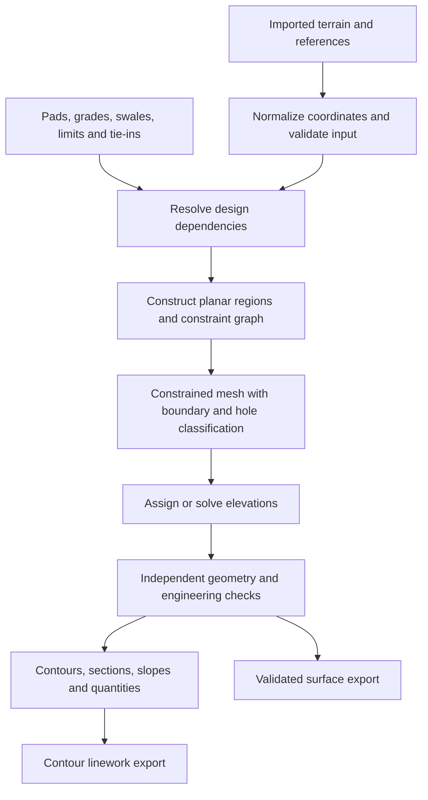

# Surface, grading, and contour engine

[Research index](../../README.md) · [Coordinates](../07-data-and-coordinates/README.md) · [Validation](../08-validation-and-testing/README.md)

## Recommended representation

Use a **2.5D constrained triangulated irregular network (TIN)** as the authoritative proposed-ground surface: each valid plan location has one elevation, and each triangle defines a plane. Store the design objects and constraints separately so the surface can be rebuilt and explained.

A plain point triangulation does not guarantee that a swale bottom, ridge, boundary, or curb edge will become a triangle edge. Constrained triangulation preserves designated plan segments. CGAL's manual explains constrained and constrained Delaunay representations, including domain boundaries. [CGAL triangulation manual](https://doc.cgal.org/latest/Triangulation_2/index.html)

This representation does not support an exactly vertical wall, overhang, bridge, or two different elevations at the same XY within one connected surface. In the initial release, flag and block unsupported discontinuities in affected grading operations. Later support requires separate surface patches and an explicit wall/interface model, or a documented finite-width approximation. Do not silently merge top and bottom elevations.

## End-to-end computation pipeline



All output should carry the project revision and surface revision. An invalid or unfinished preview must not replace the last accepted result.

## Build deterministic grading before optimization

The first engine should implement explicit, reviewable operations:

| Operation | Proposed construction | Important failure cases |
| --- | --- | --- |
| Pad or tilted plane | Boundary plus plane equation and explicit relationship to floor elevation | Conflicting elevations, unintended ground inside building |
| Fixed-width yard band | Offset edge and apply specified horizontal-distance grade | Concave offsets, overlapping bands, narrowed side yards |
| Swale | Longitudinal control line and grade; banks from width/side-slope definition | Missing outlet, flat/reversed segment, crossing another control |
| Driveway | Cross-section controls and longitudinal stations tied to garage and street | Breakover/transition problems, conflicting crossfall |
| Daylight slope | Project a defined slope toward the reference terrain; trace intersections and stitch a valid boundary | No solution, multiple intersections, offset collisions, no terrain coverage |
| Infill | Triangulate bounded, compatible feature regions and interpolate or solve remaining elevations | Underconstrained areas, poor triangle quality, unintended low points |

For a selected horizontal direction **d** of unit length, a simple slope projection from point **p₀** is:

```text
p(t) = p₀ + t d
z_design(t) = z₀ + s t        # s is signed vertical / horizontal slope
find t >= 0 with z_design(t) = z_existing(p(t))
```

Intersect against EG triangle planes within their plan domains rather than taking large sampling steps that can miss an intersection. Define first-valid-intersection behavior, cut/fill selection, maximum search extent, and corner transitions. Pointwise rays alone do not produce a correct daylight surface around complex corners; validate the assembled result for gaps, overlaps, and self-intersections. Limit the initial operation to documented supported configurations if necessary.

For an inferred interior vertex, record the interpolation/solver rule that assigned its elevation. Constrained triangulation solves XY topology; it does **not** decide correct Z values or engineering intent.

## Robust geometry and precision

Use double precision for engineering coordinates, a local computational origin, and robust orientation/incircle predicates. Near-degenerate geometry can make ordinary floating-point predicate signs incorrect; Shewchuk's work provides adaptive techniques for these decisions. [Primary research and implementation](https://www.cs.cmu.edu/~quake/robust.html)

Normalize a planar straight-line constraint graph before meshing:

1. Validate rings, finite coordinates, minimum edge lengths, and permitted intersections.
2. Split intersections and preserve stable identities for original constraints and subsegments.
3. Resolve the Z values contributed by every intersecting design feature. If incompatible, report both features and the mismatch.
4. Classify outer boundaries and holes explicitly. Internal breaklines are not automatically hole boundaries.
5. Insert constraints, refine where appropriate, and classify triangles by the intended domain.
6. Verify every required segment survives as an edge or chain of edges; retain the mapping back to the design object.

Use separate documented tolerances for XY coincidence, Z compatibility, area, contour stitching, and export precision. Do not fix all numerical problems by increasing one global epsilon. Tolerances are proposed project/engine settings, not statements of survey accuracy.

Polygon clipping/offsetting can use Clipper2. Its integer-based calculations require deliberate scaling, with small-feature and rounding effects evaluated against the product's precision budget. [Clipper2 robustness reference](https://www.angusj.com/clipper2/Docs/Robustness.htm)

## Contour extraction

For interval **Δz > 0**, base elevation **b**, and integer **k**, contour level **h = b + kΔz**. Generate segment intersections directly from the accepted TIN. On an edge from A to B that straddles h:

```text
t = (h - zA) / (zB - zA)
P = A + t (B - A)
```

The regular triangle case yields one contour segment. Implementation must also define exact-on-level vertices, level edges, coplanar triangles, saddle vertices, and disconnected regions. A plateau is not a uniquely located contour line across its interior: handle it as a documented plateau case rather than manufacturing dense linework.

Use a consistent half-open/sign convention and canonical mesh-edge identities to avoid duplicate segments. Assemble connected linework using topology first, with bounded coordinate tolerance only where needed. A saddle can have multiple branches meeting at a vertex; preserve and deterministically split that topology rather than forcing every contour node to degree two. Clip to the accepted surface domain and holes. Use integer level indices for major/minor classification, including negative elevations.

Initially export unsmoothed, elevation-correct polylines. Later simplification must bound displacement and avoid crossings or protected features. Display smoothing can be optional and clearly identified. Exporting a curve that leaves the actual surface changes the apparent design even if its nominal Z stays constant.

Raster contours are useful for DEM workflows, but rasterizing this design TIN just to extract contours introduces a resolution choice and can lose narrow features. GDAL documents its raster contour algorithm separately; it is a reference or later raster-import path, not a replacement for TIN contouring here. [GDAL contour API](https://gdal.org/en/stable/api/gdal_alg.html)

## Slope and drainage diagnostics

For triangle plane **z = ax + by + c**, the steepest slope magnitude is **sqrt(a²+b²)**. Percent slope is 100 times that value. Downhill plan direction is **(-a,-b)**. A directional route grade uses the gradient projected onto the route direction; crossfall uses its perpendicular.

Follow flow through triangle interiors and across edges, with explicit valley-edge, ridge, vertex, flat-area, and outlet behavior. A graph that sends each vertex to a lower neighbor is a useful approximation but can miss the actual piecewise-planar flow path. Report flat/ambiguous paths, closed depressions, and flow into excluded or unknown areas. Do not fill depressions in the design surface merely to make a diagnostic route reach an outlet.

For routes and tie-in edges, evaluate every intersection with a terrain edge and every feature grade break; sparse endpoint sampling can miss the maximum violation. Verify the continuous affected boundary, not just its corners.

## Earthwork volumes

Let **d(x,y) = z_FG - z_EG** over a declared shared horizontal domain. Positive d is fill; negative d is cut. Overlay the two TINs so both elevations are linear within each common cell. Split cells on d = 0, triangulate them, and integrate:

```text
signed volume of a common triangle = plan area × (d1 + d2 + d3) / 3
```

Sum positive and negative subregions separately. Using only the FG vertices against EG without a mesh overlay is generally not exact when EG edges cross a proposed triangle. Keep gross cut, gross fill, and net volume distinct. An unsigned or net-only figure can conceal large opposing quantities.

Report areas excluded by buildings/holes and areas lacking EG coverage. Finished-ground differences do not automatically include stripping, pavement thickness, foundation excavation, unsuitable material, shrink/swell, or compaction. Add these as explicit, separately reported models if required.

## Optional constrained elevation assistance

After deterministic editing is reliable, evaluate optimization on fixed XY topology with variable elevations **zᵢ**. A possible convex quadratic objective combines deviation from a preferred design and differences in triangle gradients across smooth interfaces. Normalize terms for mesh size and units; do not smooth across intentional crests or swales.

Linear constraints can encode locked elevations, upper/lower bounds, and prescribed directional falls. For a directed edge from upstream i to downstream j:

```text
zᵢ - zⱼ >= minimum_grade × horizontal_length(i,j)
```

OSQP supports convex quadratic objectives with linear constraints and is a candidate for this limited formulation. [Solver documentation](https://osqp.org/docs/)

Important formulation limits:

- A true triangle gradient cap **sqrt(a²+b²) ≤ gmax** is a second-order cone constraint, not a linear OSQP constraint. Independent edge caps do not guarantee that gradient bound. Use a suitable conic solver, a justified conservative approximation, or an independently checked limited feature scope.
- A minimum downhill magnitude with an unknown direction is nonconvex. Prescribe drainage topology/directions before using the simple convex formulation.
- Walls, changing topology, outlet choice, and “choose which way this yard drains” are additional discrete/geometric decisions.
- Penalized slack does not make an infeasible engineering design acceptable. Show residuals in project units and every relaxed requirement.

Return explicit states: valid, valid with acknowledged advisory issues, invalid/conflicting, underconstrained, cancelled, and numerical failure. Never present a failed solve as a completed grading design.
